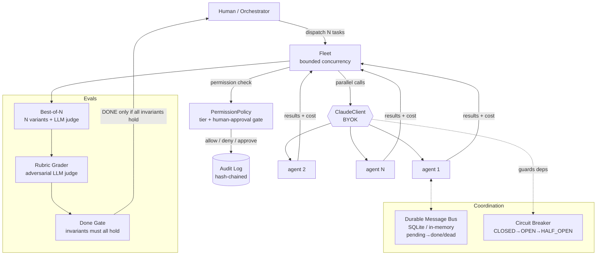

# orchestra

**Production multi-agent orchestration + eval harness on Claude.**

`orchestra` is a small, dependency-light Python library for the pattern at the
heart of every serious agentic system: **one human (or one orchestrator) drives
N Claude agents in parallel, with guardrails and evals so the output is
trustworthy.** It is the distilled, generic core of a multi-agent system that has
run in production — refactored to be reusable, bring-your-own-key, and free of
any private coupling.

It gives you five composable pieces:

| Piece | Module | What it does |
|---|---|---|
| **Fleet** | `orchestra.fleet` | Fan out N agent runs in parallel under a hard concurrency cap. Failure-isolated, cost-attributed, permission-gated. |
| **Message bus** | `orchestra.bus` | Durable, receipted inter-agent messaging with a strict status machine (`pending → processing → done \| failed \| dead`). A dropped message dead-letters loudly; it never silently returns empty. |
| **Circuit breaker** | `orchestra.circuit_breaker` | Per-dependency breaker so a dead credential or 500ing API can't spin an agent in an infinite, silent error loop. Trips OPEN, alerts once, probes for recovery. |
| **Best-of-N** | `orchestra.variants` | Run N `(model, temperature)` variants of a prompt in parallel, then have an **adversarial LLM judge** score each and pick a winner with a justification. |
| **Eval harness** | `orchestra.eval` | An **LLM-judge rubric grader** and a **definition-of-done gate** (an ordered list of machine-checkable invariants that must *all* hold before work is called "done"). |

Cross-cutting: a **capability-vs-risk permission layer** (`orchestra.permissions`)
with graduated tiers, a human-approval gate for irreversible actions, and a
tamper-evident, hash-chained **audit log**.

---

## Architecture



The controller stays in charge: it decides *what* fans out, *how many* run at
once, *which tier* each agent may act at, and *whether the result is good enough
to ship*. Agents do the work; the harness makes their work safe and verifiable.

---

## Quickstart (5 minutes)

```bash
git clone https://github.com/ai-foundry-byu/orchestra-agents
cd orchestra-agents
pip install -e ".[dev]"        # tests only; no API key needed
python -m pytest -q            # 61 tests, fully offline, ~0.1s
```

Run the end-to-end demo **offline and free** (uses the built-in `FakeClient`):

```bash
python examples/fanout_and_gate.py
```

```
=== 1. Parallel fan-out (Fleet) ===
  summary: {'total': 3, 'done': 3, 'failed': 0, 'total_cost_usd': 0.000567, 'errors': []}
  audit intact: True
=== 2. Best-of-N with an adversarial judge ===
  winner=#1  rationale='clearest'
=== 3. Rubric grade of the winner (LLM judge) ===
  score=0.9667  passed=True  (solid)
=== 4. Definition-of-Done gate ===
  DONE — all 2 critical invariants hold
```

Run it **for real** against Claude — bring your own key:

```bash
pip install -e ".[anthropic]"
export ANTHROPIC_API_KEY=sk-ant-...        # never hardcoded, never written to disk
python examples/fanout_and_gate.py --live
```

### Minimal fan-out

```python
from orchestra import Fleet
from orchestra.client import ClaudeClient
from orchestra.fleet import AgentTask

fleet = Fleet(ClaudeClient(), max_parallel=6)
handles = fleet.map("summarizer", ["doc A...", "doc B...", "doc C..."])
print(Fleet.summary(handles))   # {'total': 3, 'done': 3, 'total_cost_usd': ...}
```

### Best-of-N + judge

```python
from orchestra import best_of_n, Variant
from orchestra.client import ClaudeClient

client = ClaudeClient()
outcome = best_of_n(client, "Explain idempotency in one sentence.", [
    Variant("claude-opus-4-20250514", 0.7),
    Variant("claude-sonnet-4-20250514", 0.5),
    Variant("claude-sonnet-4-20250514", 1.0),
])
print(outcome.winner.text, "—", outcome.rationale)
```

### Definition-of-done gate

```python
from orchestra.eval import DoneGate, Invariant

gate = DoneGate([
    Invariant("deployed sha matches", lambda: (deployed_sha() == expected, "...")),
    Invariant("smoke test passes",    run_smoke_test),
])
result = gate.run()
if not result.passed:
    raise RuntimeError(result.summary)   # never call it "done" on a vibe
```

---

## Capability vs. risk

Multi-agent systems are dangerous because they *act*. `orchestra` treats
capability and risk as first-class, mirroring a least-privilege + human-in-the-
loop posture:

- **Graduated permission tiers.** Every action is `READ` < `WRITE` < `EXTERNAL`
  < `IRREVERSIBLE`. Each agent is granted a *maximum* tier; anything above it is
  denied **before a token is spent**.
- **Human-approval gate for irreversible actions.** The top tier (deploy to
  prod, delete data, spend money) will not proceed without an explicit approver
  callback returning `True`. No approver ⇒ it refuses.
- **Tamper-evident audit log.** Every allow / deny / approval is appended to a
  SHA-256 **hash-chained** log. Altering any historical entry invalidates the
  chain; `audit.verify()` proves integrity.
- **No silent failures.** The message bus dead-letters (never empties) on
  failure; the circuit breaker stops runaway error loops and alerts exactly
  once; the done-gate refuses to declare success until every invariant holds.

See [`docs/DESIGN.md`](docs/DESIGN.md) for the rationale and the field-tested
failure modes each guardrail exists to prevent.

---

## Why it's built this way

- **BYOK & no lock-in.** The whole library targets a tiny `AgentClient` protocol.
  The real client wraps the Anthropic SDK and reads `ANTHROPIC_API_KEY` from the
  environment; a `FakeClient` makes the entire suite run offline and free. Swap in
  Bedrock/Vertex/a proxy without touching orchestration code.
- **Durable by default, not distributed by default.** The bus is honest about its
  guarantees: SQLite (WAL) gives you crash-durability with zero services. It
  survives a process crash — not a full-machine outage (that needs replication),
  and the docs say so.
- **Tested.** 61 unit tests, deterministic, offline, ~0.1s. Every guardrail has a
  test proving the failure mode it prevents.

## License

MIT — see [LICENSE](LICENSE).
